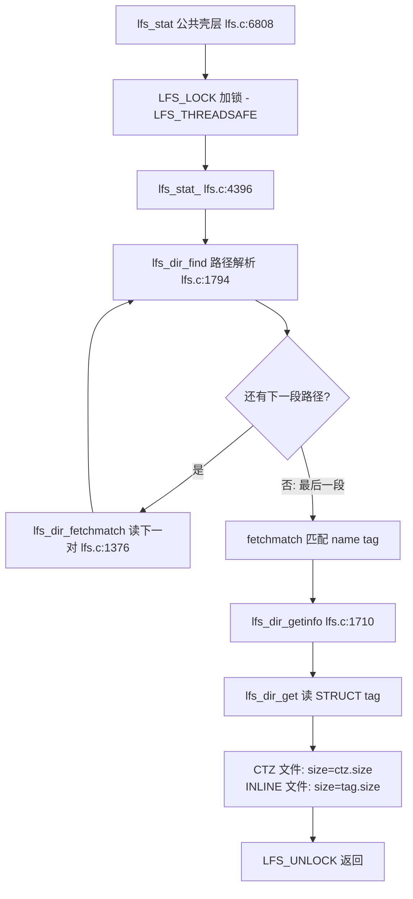
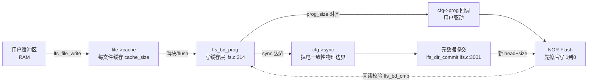

# littlefs 源码详解 00：总览与设计哲学

> **涉及文件**
> - `lfs.c`（核心实现，共 7314 行，注释后）
> - `lfs.h`（公共 API 与数据结构，共 955 行）
> - `lfs_util.c` / `lfs_util.h`（CRC 与工具，55 / 341 行）
> - `bd/lfs_rambd.c`、`bd/lfs_filebd.c`、`bd/lfs_emubd.c`（块设备层）
> - `DESIGN.md`、`SPEC.md`（官方设计/盘上格式文档）

littlefs 是 ARM 官方为 MCU 设计的掉电安全文件系统。它回答的问题只有一个：
**如何在 32 KiB RAM、随时可能断电、写坏一块就少一块的 flash 上，做一个"永远不会坏"的文件系统？**

---

## 1. 三大约束与代价模型

DESIGN.md 开篇列出的三条硬约束，决定了全部架构：

| 约束 | 含义 | littlefs 付出的代价 |
| --- | --- | --- |
| 掉电安全 | 任意时刻断电，回到上一次一致状态 | 一切更新走 copy-on-write + 双块日志（空间开销 ~4x 元数据） |
| 磨损均衡 | 写入摊到全盘，避免热块早死 | 只做**动态**均衡（不动已有数据块），靠随机起点 + 主动搬迁 |
| RAM/ROM 有界 | RAM 不随文件数增长 | 目录遍历变成 O(n) 链表走链，文件读取用 CTZ 跳表换指针 |

**代价模型**是理解 littlefs 的钥匙：

- 元数据对（目录）：每个条目摊上 **~4 倍空间**（50% 分家阈值 × 双块冗余）。
- 文件数据：CTZ 跳表平均每块 **2 个指针 = 8 字节**开销，无写放大。
- RAM：固定 `2*cache_size + lookahead_size + 每打开文件 1*cache_size`，
  外加 `lfs_t` 骨架约 100 字节级——**与文件数量、盘大小无关**。
- 复杂度：读路径 O(n log n)（被 block_size 除后近似线性）；
  目录查找 O(nm)，提交摊销 O(nm)。

## 2. 两种"积木"的化学反应

DESIGN.md 对四种传统方案做过逐一解剖，littlefs 取其二的杂交：

| 方案 | 原子性 | 性能 | 磨损 | littlefs 的取舍 |
| --- | --- | --- | --- | --- |
| FAT/ext2 原地更新 | 无 | 最好 | 无法管理 | 弃 |
| JFFS2/SPIFFS 纯日志 | 天然好 | O(n²) 或 O(n) RAM | 天然均匀 | **借"日志"但限制到 2 块**，把 O(n) 变 O(1) |
| ext4 日志 | 好 | 好 | 无法管理 | 弃（双文件系统复杂度） |
| btrfs/ZFS COW | 好 | 好 | 磨损向上传播 | **借 COW 但改成 CObW**（n 次写才复制一次），磨损每层除以 n |

两个术语：

- **小日志（metadata pair）**：两块组成的环形日志，提供"任意位置"的原子更新。
- **CObW（copy-on-bounded-writes）**：每 n 次写才复制一次的 COW 树，
  阻止磨损向根部聚焦（n > 分支因子即无传播）。

## 3. CSS 血统的日志结构

littlefs 的提交日志与 CSS（级联样式表）没有关系——这里说的是它继承自
**日志结构文件系统（LFS, Log-structured File System）** 的核心思想：

1. **追加即更新**：所有修改都是往日志尾部追加新条目，旧条目不覆盖；
2. **用校验识别未完成**：日志尾每条 commit 带 CRC，半截提交 = CRC 不匹配 =
   无视（掉电自动"回滚"）；
3. **周期性压缩**：日志满则把存活条目重写到另一块（compact），

littlefs 把"日志"限制在 **两个块**里，因此：

- GC 的 O(n²) 被 n<=块大小/条目长度 限死，摊销 O(1)；
- 50% 使用率即分家（split），避免接近满时的压缩频率爆炸；
- 双块互为备份，擦除其中一块时另一块保证完整性。

**日志结构的读路径**（`lfs_dir_getslice`，lfs.c:949）从日志尾部**反向**扫描，
第一条命中即最新版本——这是"最新数据在尾部"的直接推论。

## 4. 全景文件表

| 文件 | 行数 | 职责 | 关键入口 |
| --- | --- | --- | --- |
| `lfs.c` | 7314 | 全部核心逻辑 | `lfs_format`(6695) `lfs_mount`(6726) `lfs_file_*` `lfs_dir_*` |
| `lfs.h` | 955 | API 契约与 RAM 结构 | `struct lfs_config`(199) `lfs_t`(542) |
| `lfs_util.c` | 55 | CRC32 软件实现 | `lfs_crc`(35) |
| `lfs_util.h` | 341 | 调试宏/位运算/端序 | `lfs_ctz`(194) `lfs_popc`(209) `lfs_scmp`(226) |
| `bd/lfs_rambd.c` | 131 | RAM 模拟盘 | `lfs_rambd_create` |
| `bd/lfs_filebd.c` | 178 | 文件模拟盘 | `lfs_filebd_create` |
| `bd/lfs_emubd.c` | 758 | 高仿盘（坏块/掉电注入） | `lfs_emubd_prog`(356) |

## 5. 读路径执行流（flowchart TD）

以 `lfs_stat("/cfg.txt")` 为例，从 API 到驱动：

## 6. 数据流总览（flowchart LR）

一次 `lfs_file_write` 的数据旅程（也适用于元数据提交）：

## 7. 与"重启即坏"的 FAT 对比一例

写文件途中断电：

- FAT：目录项已指向新簇链， FAT 表半更新 => 交叉链接文件。
- littlefs：数据块是孤立的（没有元数据指向它们），元数据对里仍是旧
  commit => 挂载即回到旧版本，新块被分配器当作空闲块回收。

这就是"掉电安全的全部秘密"：**新状态永远先有数据、后有指针，
指针切换本身是一次原子提交**。

## 8. 读码路径建议

1. 本文 -> 02（元数据对） -> 01（CTZ/目录） -> 03（掉电恢复） -> 04（磨损均衡）。
2. 源码顺序：`lfs.h` 的 `lfs_config/lfs_t` -> `lfs.c` 的 `lfs_bd_*` 缓存层 ->
   `lfs_alloc` -> `lfs_dir_*` 提交族 -> `lfs_file_*` -> `lfs_fs_*`。
3. 跑一次 `make test`（见 07 篇）再回头读 `lfs_fs_deorphan`（lfs.c:5637），
   体感完全不同。

## 9. 陷阱与实测建议

- `block_cycles=0` 已被禁止（lfs_init 断言，lfs.c:4762），想关磨损均衡用 `-1`。
- RAM 预算别忘了打开文件数：每个 `lfs_file_t` + `cache_size` 字节。
- 元数据对是"每目录"的：把大量小文件平铺在根目录 vs 分目录，
  空间利用率可能差数倍（inline 文件 + 目录对摊销）。
