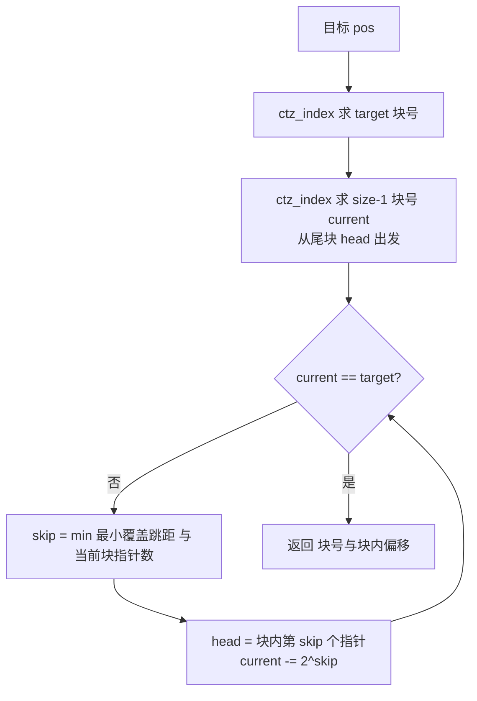
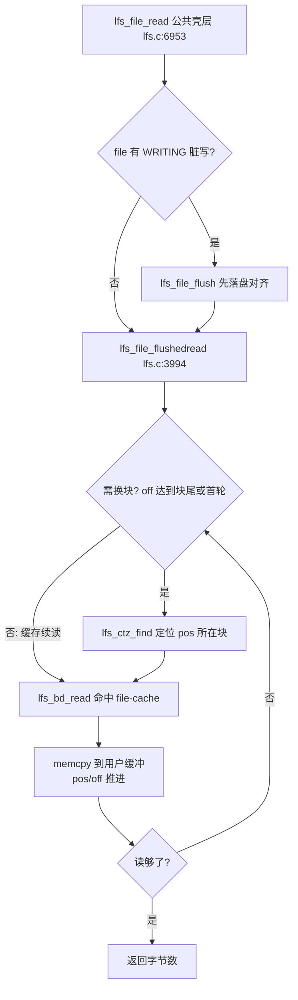
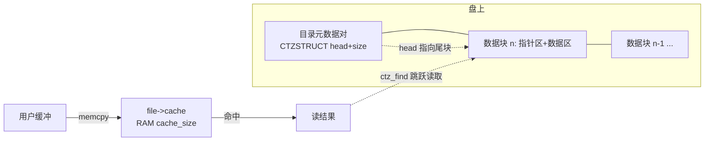

# littlefs 源码详解 01：目录与文件模型（inode / CTZ 跳表 / 读路径）

> **涉及文件**
> - `lfs.c`：`lfs_dir_find`(1794)、`lfs_dir_fetchmatch`(1376)、`lfs_dir_getslice`(949)、
>   `lfs_ctz_index`(3305)、`lfs_ctz_find`(3324)、`lfs_file_read_`(4056)
> - `lfs.h`：`lfs_file_t`(486)、`lfs_mdir_t`(450)
> - `SPEC.md`：Metadata tags 一节

littlefs 没有 FAT 式的"目录表"，也没有 ext 的独立 inode 区。
**目录 = 元数据对链表，文件 = 目录里的一条 tag + 一条 CTZ 跳表（或 inline 内联）**。

---

## 1. 一切皆 tag：元数据条目模型

每个目录（元数据对）里存着一串 tag。用户视角只关心这几类：

| tag 类型 | 值 | 数据 | 作用 |
| --- | --- | --- | --- |
| NAME | `0x0xx` | 文件类型+名字 | id 与名字绑定（REG=0x001/DIR=0x002） |
| INLINESTRUCT | `0x201` | 文件数据本体 | 小文件直接嵌在目录里（inline 文件） |
| CTZSTRUCT | `0x202` | `{head, size}` 各 4 字节 | 大文件的 CTZ 跳表入口 |
| DIRSTRUCT | `0x200` | `{pair[2]}` 8 字节 | 子目录的元数据对指针（=inode） |
| USERATTR | `0x3xx` | 属性数据 | 自定义属性（时间戳等） |
| CREATE/DELETE | `0x401/0x4ff` | 无 | id 的插入/删除（SPLICE，搬移后续 id） |
| TAIL | `0x600/0x601` | `{pair[2]}` | soft/hard 尾指针（目录链） |
| CRC | `0x5xx` | CRC+padding | 提交收尾 |

tag 编码 `[valid 1|type3 11|id 10|size 10]`，RAM 中用 `LFS_MKTAG`(lfs.c:466)
组装：`type<<20 | id<<10 | size`。

**id 是目录内的"数组下标"**：文件按名字字典序排 id；CREATE/DELETE 会让
后续 id 整体 ±1（读取时 `lfs_dir_getslice` 用 `gdiff` 累计修正）。

## 2. 目录：元数据对的链表

```
root 对 ──hardtail──> 对 B(继续本目录) ──softtail──> 对 C(下一目录)
   │文件A id=1          │文件D id=2
   │文件B id=2          │文件E
   └子目录 id=3 ──DIRSTRUCT──> 子目录自己的对
```

- **hardtail**：同目录跨块（字典序分家，50% 阈值触发）；
- **softtail**：链到无关的下一目录，只为全盘遍历（分配器扫描）存在。

`lfs_dir_find`(lfs.c:1794) 沿树逐段下钻：对每段路径调
`lfs_dir_fetchmatch`(1376) 带名字匹配回调（`lfs_dir_find_match`，
逐字节 `lfs_bd_cmp`）。`.`/`..` 在这里就地消化，`..` 越根报 `LFS_ERR_INVAL`。

## 3. 文件的两种形态

**inline 文件**（`LFS_F_INLINE`，head=`LFS_BLOCK_INLINE`=-2）：
- 数据直接放在目录对的 INLINESTRUCT tag 里；
- 阈值 `inline_max = min(cache_size, attr_max, block_size/8)`（lfs_init 解析）；
- 4 字节小文件的盘上成本 ≈ 16 字节，而独立成块要 2×block_size。

**CTZ 文件**：超过 inline_max 后 `lfs_file_outline`(3815) 搬出成块链。

## 4. CTZ 跳表：为"无界 RAM"而生的跳表

文件数据块从新到旧链接（backwards），且第 n 块存 `ctz(n)+1` 个指针，
分别指向第 `n-1`、`n-1-2^0`、`n-1-2^1` … 块：

```
块5(3指针)─>块3─>块1        （跳表层）
  │        │
块5─>块4─>块3─>块2─>块1─>块0 （链表层）
```

为什么是 backwards？**追加写 O(1)**：新块只需自己的指针区，
旧链一字节不动——COW 成本为零。顺读则靠多层指针做 O(log n) 跳跃。

### 4.1 核心数学（lfs_ctz_index，lfs.c:3305）

利用恒等式 `Σ(ctz(i)+1) = 2n - popcount(n)`（OEIS A001511/A005187），
把 O(n) 的"数指针"求和化为 O(1)：

```c
// 摘录自 lfs.c:3305（lfs_ctz_index）
lfs_off_t b = lfs->cfg->block_size - 2*4;
lfs_off_t i = size / b;
i = (size - 4*(lfs_popc(i-1)+2)) / b;
*off = size - b*i - 4*lfs_popc(i);
return i;
```

两行修正即得精确块号：先按"每块净容量 b"估出 n'，再用 popcount
吃掉指针区误差。**这就是文件元数据只需 `{head, size}` 8 字节的全部代价。**

### 4.2 跳表查询（lfs_ctz_find，lfs.c:3324）



### 4.3 追加（lfs_ctz_extend，lfs.c:3369）

1. `lfs_alloc` 拿新块、擦除；
2. 旧尾块未满 => 先逐字节 COW 进新块（顺带把"半块数据"收编）；
3. 写 `ctz(index)+1` 个指针（写一个、沿旧链读一个）；
4. 返回数据区写偏移 `4*skips`。

坏块？`goto relocate` 换块重来——RAM 里数据还在，零损失。

## 5. 读路径执行流（flowchart TD）

`lfs_file_read` 读 1 KiB（非 inline 文件）：



inline 文件的读在 `lfs_dir_getread`（按 tag 从元数据对切片），
哨兵块号 `LFS_BLOCK_INLINE` 复用同一套缓存逻辑。

## 6. 数据流（flowchart LR）



## 7. 数量级速查

| 项 | 数值（默认配置） |
| --- | --- |
| 平均指针开销 | 2 指针/块 = 8 B（32 位 width） |
| 单块最多指针 | `npw2(0xffffffff/(B-8))` 个，B≥104 B 恒不溢出 |
| 读 1 MB 文件最多 IO | ~256 块 × log 因子（4 KiB 块） |
| inline 阈值 | min(cache_size, attr_max, block_size/8) |
| 追加写放大 | 0（只写新块自己的指针区） |

## 8. 陷阱与实测建议

- `lfs_file_seek` 只改 RAM 的 pos；跨块 seek 会触发 flush（COW 分支收敛），
  频繁随机写会放大擦写——顺序写是 littlefs 的最佳姿势。
- inline 文件膨胀到阈值时首次写会**卡一次 outline**（搬数据），
  实时敏感路径建议预判文件大小。
- 两个句柄写同一文件：`lfs_file_sync_` 会给对方打 `LFS_F_DUSTY`，
  但同步靠调用方自觉（littlefs 不做并发文件一致性）。
