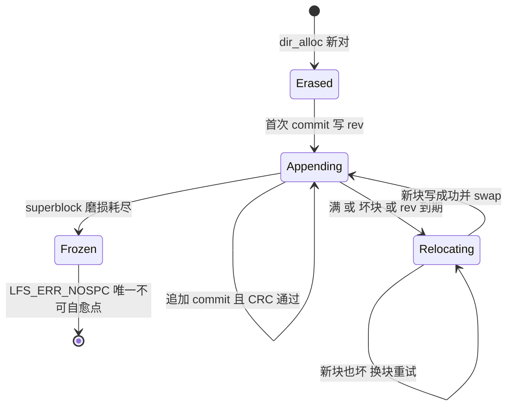
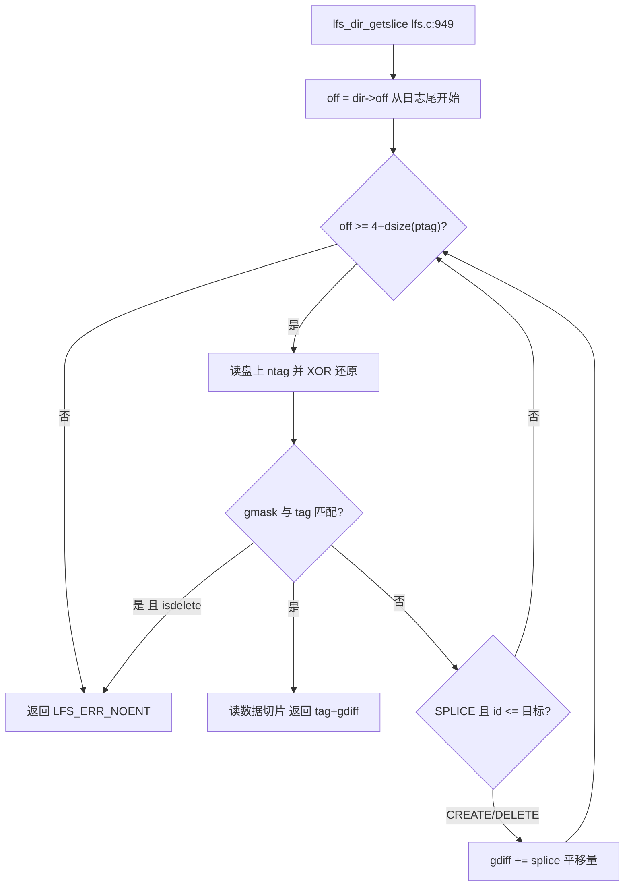
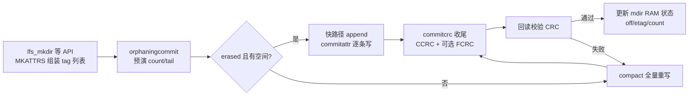

# littlefs 源码详解 02：元数据对与提交日志（commit / CRC / 双块裁决）

> **涉及文件**
> - `lfs.c`：`lfs_dir_fetchmatch`(1376)、`lfs_dir_commit`(3001)、
>   `lfs_dir_relocatingcommit`(2620)、`lfs_dir_compact`(2320)、
>   `lfs_dir_commitattr`(1943)、`lfs_dir_commitcrc`(2000)、`lfs_dir_getslice`(949)
> - `lfs.h`：`lfs_mdir_t`(450)
> - `SPEC.md`：Directories / Metadata pairs、Metadata tags 两节

元数据对（metadata pair）是 littlefs 的脊柱：**两块互为备份的小日志**，
全文件系统（包括 superblock）的每次更新都是对某个元数据对的一次"提交"。

---

## 1. 元数据块的盘上形态

```
块布局（SPEC.md）:
.---------------------------------------.
| revision count (4B) |  commit1 条目   |
|                     |  commit1 CRC    |
|---------------------+-----------------|
|        commit2 条目 |  commit2 CRC    |
|---------------------+-----------------|
|            未写区域 (全 0xff)          |
'---------------------------------------'
```

- **revision count**：每擦一次 +1，既当新旧裁决也当磨损计数；
- 条目 = tag(大端) + 数据，相邻 tag **互相 XOR** 成链（正反双向可扫）；
- 每 commit 以 CRC tag 收尾，padding 不参与 CRC。

## 2. 双块裁决：谁是最新的？

`lfs_dir_fetchmatch`(lfs.c:1376) 是唯一读入口：

1. 读两块头 4 字节 rev；
2. `lfs_scmp(revs[i], revs[(i+1)%2]) > 0`（序列算术，回绕安全）定出新块；
3. 新块排到 `dir->pair[0]`，从它开始扫 commit；
4. 整块无有效 commit（`dir->off == 0`）→ 换另一块再试。

```c
// 摘录自 lfs.c:1405（lfs_dir_fetchmatch）
if (err != LFS_ERR_CORRUPT &&
        lfs_scmp(revs[i], revs[(i+1)%2]) > 0) {
    r = i;
}
```

**为什么 rev 不会立刻失效**：compact 时新 rev 先写盘（"rev 先行"），
因此两块 rev 永不相等；比较用 `int32_t` 差值的无符号解释，
`0xffffff00` 与 `0x00000010` 也能正确裁决（RFC1982）。

## 3. 一次提交的解剖

`lfs_dir_commit`(3001) → `lfs_dir_orphaningcommit`(2801) →
`lfs_dir_relocatingcommit`(2620)，三层的分工：

| 层 | 职责 |
| --- | --- |
| commit | 总入口；完成后若有连锁孤儿则同步 deorphan |
| orphaningcommit | 处理搬迁后父指针/前驱 tail 的连锁更新 |
| relocatingcommit | 真正落笔：能追加则追加，否则 compact |

**快路径**（`erased==1` 且未满）：

```
dir->off 处直接 prog: ntag | 数据 | ... | CRC tag
```

掉电一致性窗口 = 这一次 append + CRC。CRC 没写全 = fetch 时判无效 = 旧版本。

**慢路径**（无空间/到期）：`lfs_dir_splittingcompact` → `lfs_dir_compact`(2320)：
擦 pair[1] → 写 rev → 全量存活条目（traverse 过滤旧版本）→ tail → gstate → CRC，
成功后 `lfs_pair_swap` 把新块抬进 pair[0]。

### 3.1 commit 游标（struct lfs_commit，lfs.c:1906）

| 字段 | 含义 |
| --- | --- |
| block/off | 写入位置 |
| ptag | 上一条明文 tag（新 tag 与它 XOR 后写盘） |
| crc | 运行 CRC（初值 0xffffffff） |
| begin/end | 日志区间（end 预留 8 字节给收尾） |

`lfs_dir_commitattr`(1943)：写出 tag+数据；tag 高位 0x80000000 表示
"数据在盘上"（`struct lfs_diskoff`），move 搬运直通盘到盘。

### 3.2 收尾的艺术（lfs_dir_commitcrc，lfs.c:2000）

CRC tag 有两种形态：

| 形态 | 尺寸 | 场景 |
| --- | --- | --- |
| 中部 CCRC | 4+4+2×4=…，带 **FCRC** | 后面还有空间，需校验下一窗口擦除态 |
| 块尾 CCRC | 2 词 | 无后续写，无需 FCRC |

- **FCRC**（lfs2.1）：记录"下一 prog_size 窗口在擦除态的 CRC"。
  掉电可能把下一次提交写了一半，仅凭 valid 位不够——FCRC 对不上
  就断定"下次提交区脏了"，宁可 compact 不冒险。
- **eperturb 技巧**：若下一窗口首字节恰好等于擦除值，本次 valid 位
  翻转无法写进介质，CCRC 的 chunk bit0 强制翻转，保证下一提交判无效。
- **收尾校验**：padding 不在 CRC 内，因此回读分两段——
  非 padding 区 CRC 比对 + 单独验证 `CRC(crc)==0`（CRC 自校验），
  防止"捡到"无关的旧提交。

## 4. 提交状态机（stateDiagram-v2 必画）



状态迁移对应的源码锚点：

- `Appending`：relocatingcommit 的快路径（lfs.c:2657，`dir->erased && dir->count < 0xff`）；
- `Relocating`：compact 的 `relocate` 标签（lfs.c:2465，`lfs_alloc` 换 pair[1]）；
- `Frozen`：compact 中 superblock 判定 `has become unwritable` 返回 NOSPC（lfs.c:2475）。

## 5. 读取：反向扫描与 splice 修正（flowchart TD）



## 6. 一条提交的完整数据流（flowchart LR）



## 7. 量化：一次 rename 的提交数

| 操作 | 提交次数 | 涉及元数据对 |
| --- | --- | --- |
| 同目录改名 | 1 | 1 |
| 跨目录移动（文件） | 2 | 目标对、源对 |
| 跨目录移动 + 两对都要 compact | 2+N | +搬迁重写 |

`lfs_rename_`（lfs.c:4508）正是"两段式原子"：目标对先提交
`CREATE+NAME+FROM_MOVE` 并把 move 写进 gstate，源对再 DELETE 并清 gstate
（详见 03 篇）。

## 8. 陷阱与实测建议

- 元数据对接近满时追加失败会触发整对 compact，**单次 API 调用的时间
  尖峰**来自这里；可用 `lfs_fs_gc`（lfs.c:7251）提前摊平。
- `metadata_max` 可把 compact 上限压小（大块设备 128 KiB 时强烈建议）。
- tag 的 XOR 链意味着**不能单独改一条历史记录**——审计/取证工具
  必须从头重放（可参考 scripts/lfsdump.py 思路）。
