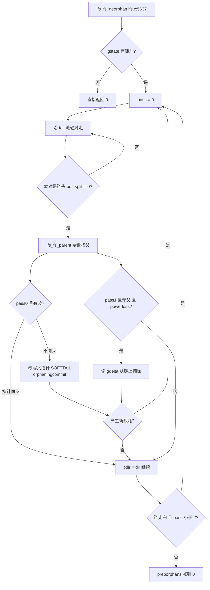
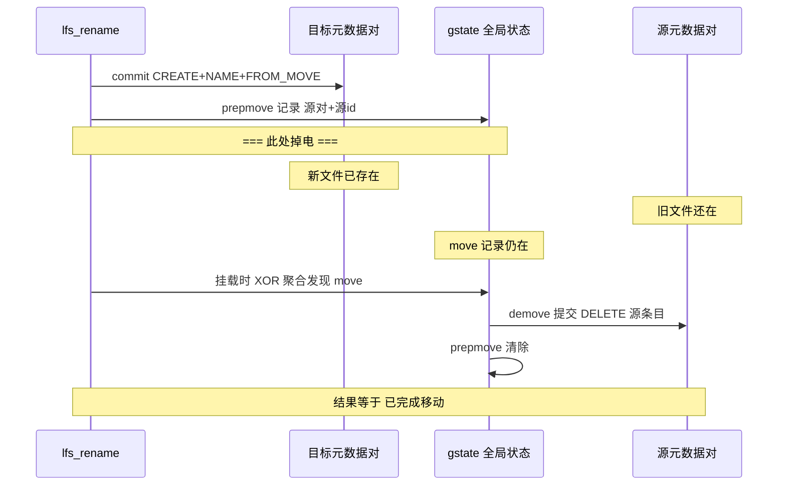
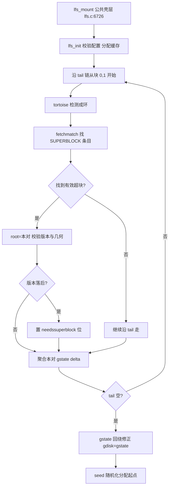
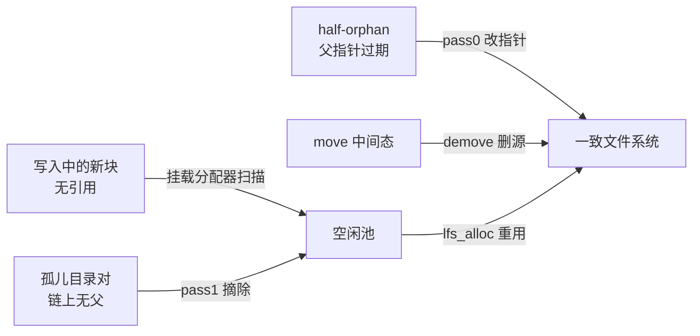

# littlefs 源码详解 03：掉电一致性与 deorphan（孤儿回收 / 软硬格式化）

> **涉及文件**
> - `lfs.c`：`lfs_fs_deorphan`(5637)、`lfs_fs_demove`(5593)、`lfs_fs_desuperblock`(5548)、
>   `lfs_fs_forceconsistency`(5777)、`lfs_fs_preporphans`(5520)、`lfs_fs_prepmove`(5537)、
>   `lfs_format_`(4964)、`lfs_mount_`(5068)
> - `lfs.h`：`lfs_gstate_t`(526)

littlefs 的掉电安全不是"不会掉电"，而是**把掉电可能留下的每一个中间态
都变成合法状态，并给出确定的修复规则**。本文按"掉电窗口"逐个拆解。

---

## 1. 掉电窗口全景表

| 掉电时刻 | 盘上状态 | 挂载后行为 |
| --- | --- | --- |
| 数据块写入中 | 新块半写，无元数据引用 | 块被视为空闲，将被回收重用 |
| 元数据 commit 写入中 | CRC 不完整 | fetch 判无效，用旧 commit（回滚） |
| 元数据 CRC 已写完 | 新状态生效 | 正常，提交已完成 |
| compact 擦了 pair[1] | 旧块还在（pair[0]） | rev 裁决选旧块，无损 |
| mkdir 链尾插入后、父目录登记前 | 新目录对存在但无人引用 | **全孤儿**，pass1 摘除 |
| 搬迁后、父指针更新前 | 父指针指向旧对 | **half-orphan**，pass0 修复 |
| rename 第一段后 | 文件在两处都有 | **move 记录**，demove 删源 |

结论：**任何窗口掉电，最多丢"本次操作"，绝不破坏历史数据。**

## 2. gstate：跨元数据对的"全局状态"

全局状态 = 各元数据对上 MOVESTATE delta 的 XOR 和。RAM 中三副本
（`lfs.h:526`）：

| 字段 | 用途 |
| --- | --- |
| gstate | 当前值（含未落盘修改） |
| gdisk | 最近一次已落盘值（两者 XOR = 待提交 delta） |
| gdelta | compact/drop 时从别的对"偷"来的 delta |

gstate.tag 的位分配（`lfs_fs_preporphans`，lfs.c:5520）：

- 低 9 位（size 字段）：孤儿计数（mkdir/remove/rename 流水）；
- bit9：needssuperblock（挂载到旧次版本盘）；
- bit31：有孤儿标志（提交到盘上即 MOVESTATE 的 sync 位）；
- type 字段：move 记录（DELETE tag = 源条目待删）。

## 3. deorphan：两遍扫描的修复器

`lfs_fs_deorphan`(lfs.c:5637) 的两遍设计**不是**性能优化：

```
pass0（half-orphan）：链上有父，但父目录里的 DIRSTRUCT 指针与链上
                     实际位置不同步（搬迁遗留）→ 改写父指针
pass1（全孤儿）：    链上有，但全盘找不到父（remove/rename 遗留）
                     → 从链上摘除，块自然回空闲池
```

必须先 pass0 再 pass1：half-orphan 的父指针里可能还挂着全孤儿的
引用，先修指针才能"看见"真正的全孤儿（源码注释原文即此意）。



**powerloss 参数的玄机**：写型 API 调 `deorphan(false)`——
mkdir 等主动操作留下的孤儿是"马上要收尾的中间态"，不能摘；
只有 `mkconsistent`/`forceconsistency` 传 `true`（怀疑掉电过）才做 pass1。

## 4. move 的掉电恢复（demove）

跨目录 rename 的两段提交与掉电时序：



`lfs_fs_demove`(5593) 的实现只有一步：fetch 源对 → DELETE 那个 id。
为什么删源就是正确语义？因为**第二段提交还没发生时，文件在两处；
删除源等价于完成移动**（目标已存在，绝不可能丢文件）。

## 5. 软硬格式化

| 种类 | API | 行为 | 何时用 |
| --- | --- | --- | --- |
| 硬格式化 | `lfs_format`（lfs.c:6695） | 重建根对+超块，历史全毁 | 首次出厂/无法挂载 |
| 软格式化（一致性） | `lfs_fs_mkconsistent`（7234） | 完成 move+摘孤儿+重写超块，数据不动 | 挂载后的例行修复 |
| 兜底重格式化 | `lfs_mount` 失败后 `lfs_format`+`lfs_mount` | README boot_count 模式 | 首次烧录 |

`lfs_fs_forceconsistency`(5777) = desuperblock → demove → deorphan(true)，
是所有写型 API 的"第一步"——**littlefs 没有 fsck，修复被摊进每次写操作**。

## 6. 超块升级（desuperblock）

挂载时发现盘是旧次版本（如 2.0 盘被 2.1 库挂载）→ 置 gstate bit9 →
首次写前 `lfs_fs_desuperblock`(5548) 重写超块（INLINESTRUCT tag）。
此后 FCRC 等 2.1 特性才可用。

## 7. 挂载主流程（flowchart TD）



## 8. 数据流：一次掉电-恢复的块账本（flowchart LR）



## 9. 陷阱与实测建议

- **实测掉电**：用 emubd 的 `power_cycles`（07 篇），每次掉电后重挂载
  并 `lfs_fs_stat`+全目录校验；官方 tests/test_powerloss.toml 是现成模板。
- `lfs_fs_mkconsistent` 是幂等的，返回 0 不代表"修过东西"（无事可修也是 0）。
- 掉电后第一次写会隐式做全套修复，**写延时会明显变大**——
  对启动时间敏感的系统应在初始化时显式调 `lfs_fs_mkconsistent`。
