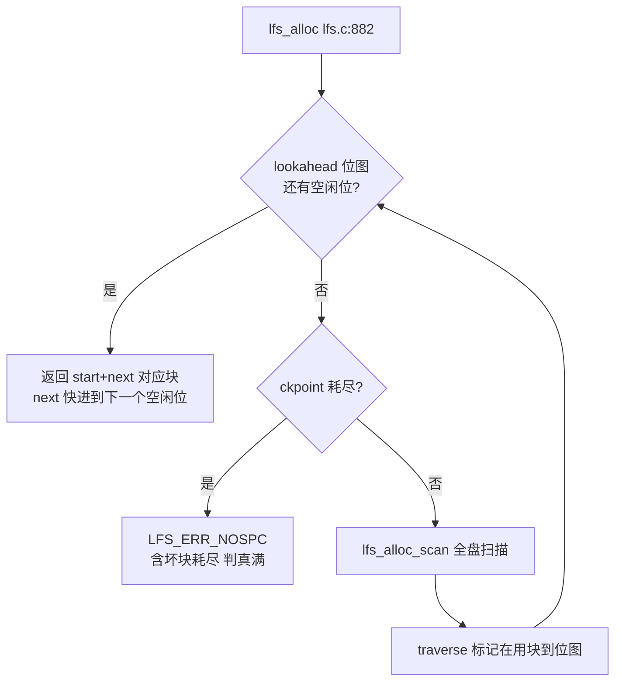
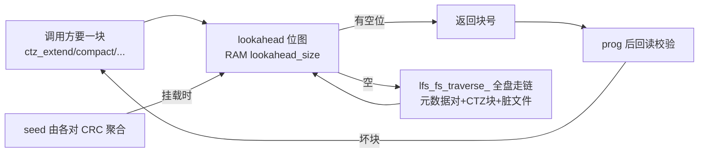

# littlefs 源码详解 04：磨损均衡与块分配（lookahead / seed / relocation）

> **涉及文件**
> - `lfs.c`：`lfs_alloc`(882)、`lfs_alloc_scan`(845)、`lfs_alloc_ckpoint`(760 区附近)、
>   `lfs_dir_needsrelocation`、`lfs_dir_compact`(2320)、`lfs_dir_splittingcompact`、
>   `lfs_fs_traverse_`(5300)、`lfs_mount_`(5068)
> - `lfs.h`：`struct lfs_config.block_cycles`、`lfs_t.lookahead`

littlefs 的磨损均衡是**被动式 + 统计式**的：不追踪每块磨损值，
靠"分配位置均匀分布"这一概率性质摊平磨损。这换来 O(1) RAM 的均衡器。

---

## 1. 没有空闲链表的分配器

盘上**不存在**空闲块列表。"没被引用的块 = 空闲块"——分配即 GC：



### 1.1 lookahead 位图

- 大小 `lookahead_size` 字节，1 字节管 8 块（RAM 换扫描时间）；
- `lfs_alloc_scan`(845)：窗口起点沿上次分配位置**绕圈推进**，
  再全盘 traverse 把在用块标 1；
- `ckpoint`：一批分配开始前的"可扫描余量记账"，防止满盘判定下溢
  （已计入余量的块不能重复计数）。

### 1.2 满盘判定的唯一出口

```c
// lfs.c lfs_alloc 内（注释后行号见文件）
if (lfs->lookahead.ckpoint <= 0) {
    LFS_ERROR("No more free space ...");
    return LFS_ERR_NOSPC;
}
```

自上次 checkpoint 起看遍所有块仍无空闲 => 真满（含坏块全部耗尽）。
所以 littlefs 报 NOSPC 时，盘上每一块都真正在用或已坏。

## 2. 随机起点：跨掉电的均匀性

上电时分配窗口从 `seed % block_count` 开始（lfs_mount_ 内）：

```
seed = CRC 链：每个元数据对每条 commit 的 CCRC 都被摘进 seed
       （lfs_dir_fetchmatch 内 lfs->seed = lfs_crc(lfs->seed, &crc, ...)）
```

为什么可行？

1. 盘上内容跨掉电不变 ⇒ seed 跨掉电稳定（不需要 RTC/NVR）；
2. 每次 commit 都会改变 CRC ⇒ 文件系统一变，seed 就变；
3. CRC 的雪崩性质 ⇒ seed 近似均匀分布。

于是"单次开机内线性绕圈" × "开机起点随机" = 长期均匀分布。
DESIGN.md 的 wear-distribution 图验证了这一点。

## 3. 元数据层面的主动搬迁：block_cycles

动态均衡只管"新分配"，热元数据对会被反复原地追加磨损。
`block_cycles` 配置让元数据对**写到寿命就主动搬家**：

```c
// lfs_dir_needsrelocation
return (lfs->cfg->block_cycles > 0
        && ((dir->rev + 1) % ((lfs->cfg->block_cycles+1)|1) == 0));
```

模数取 `(block_cycles+1)|1` 的两个 corner case（源码注释）：

1. `block_cycles=1`：模数 2 会让搬迁永不收敛；
2. `block_cycles=2n`（偶数）：对双块轮换取模会"对齐别名"，
   每次都只搬同一块，均衡失效——强制 |1 变奇数。

### 3.1 relocation 的执行（lfs_dir_compact，lfs.c:2320）

| 步骤 | 内容 | 掉电安全 |
| --- | --- | --- |
| 1 | rev+1 写进 pair[1]（先擦后写） | 掉电 => 旧对完好 |
| 2 | 全量存活条目 + tail + gstate 写入 | CRC 收尾 |
| 3 | `lfs_pair_swap` 新块上位 | 之后掉电走 rev 裁决 |
| 4 | 父指针/前驱 tail 连锁更新 | orphan/half-orphan 兜底（03 篇） |

坏块？`relocate` 标签换块重试；superblock（块 0/1）不可搬迁，
磨损耗尽返回 `LFS_ERR_NOSPC`（文件系统冻结，唯一不可自愈点）。

## 4. superblock 的求生通道

根对（{0,1}）不能搬家，只能**扩张**：`lfs_dir_splittingcompact` 检测到
根对到期且盘使用率 < ~88% 时，把超块条目分家到新对，
超块链长一格——根的磨损压力被指数级稀释。
（扩张不可回收：收缩不支持，故判据保守。）

## 5. 均衡机制全景（flowchart TD）


## 6. 分配的数据流（flowchart LR）



## 7. 配置调参演算

以 4 MiB SPI Flash、4 KiB 块 = 1024 块为例：

| 参数 | 取值 | RAM | 效果 |
| --- | --- | --- | --- |
| lookahead_size=16 | 窗口 128 块 | 16 B | 满盘 60% 时平均 2 次扫描/分配 |
| lookahead_size=128 | 窗口 1024 块 | 128 B | 基本一次扫描覆盖全盘 |
| block_cycles=500 | 每对 500 擦次搬迁 | 0 | 官方建议 100~1000 |
| block_cycles=-1 | 关闭元数据搬迁 | 0 | 超块/热目录可能早死 |

- 分配摊销：每次 scan 代价 O(在用块数)，被窗口均摊；
- 均衡不完美：静态块（冷文件）永不移动，这是与 SPIFFS 全静态均衡
  的本质差距，必要时叠 FTL。

## 8. 陷阱与实测建议

- `lfs_emubd_wear`（emubd 扩展 API）可逐块读磨损值，
  写个循环跑 1 万次 commit 后打印分布，即可"看见"均衡效果。
- 追加大文件时 `lfs_alloc` 每次 IO 后都会快进 ckpoint，
  `LFS_F_WRITING` 期间 ckpoint 被反复消耗是正常现象。
- `block_cycles` 触发的搬迁在**提交路径上**，实时任务注意用
  `lfs_fs_gc` 预热（它也会提前扫 lookahead）。
