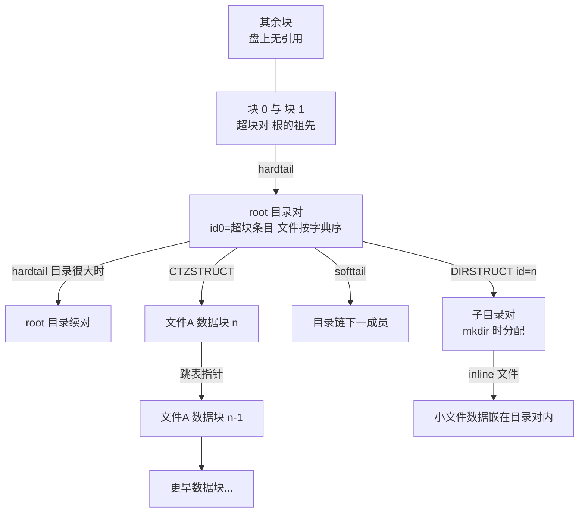

# littlefs 源码详解 05：存储布局总图（superblock / 目录 / 文件块分布）

> **涉及文件**
> - `SPEC.md`（盘上格式权威定义）
> - `lfs.c`：`lfs_format_`(4964)（布局的"生成器"）、`lfs_mount_`(5068)（布局的"读取器"）
> - `lfs.h`：`lfs_superblock_t`、`lfs_mdir_t`(450)

本文把前几篇的零件拼成一张"全盘地图"：块 0/1 是什么、目录链怎么长、
文件块躺在哪、以及一次完整写入在盘上的足迹。

---

## 1. 超块链：从 {0,1} 长出来的文件系统

littlefs 的 superblock **不是独立块**，而是沿着目录链的 id=0 条目：

```
块0/1 对（超块对, id0=superblock条目）
   │ hardtail
   v
块X 对（root 目录, 也是"最后一个超块"）
   │ hardtail（本目录文件太多时）
   v
块Y 对（root 目录续）
   │ softtail
   v
块Z 对（其它目录...）
```

- `lfs_mount_` 从 {0,1} 出发沿 tail 走，**最后一个含 SUPERBLOCK 条目的对
  就是 root**（超块链与目录链共享前缀）；
- root 每次 compact 都可能让超块链长一格（扩张），
  挂载时要走到链尾才能确定 root——所以挂载是 O(全盘对数) 的。

superblock 条目的数据（INLINESTRUCT，24 字节）：

| 字段 | 含义 |
| --- | --- |
| version | 盘上格式版本（如 0x00020001 = v2.1） |
| block_size / block_count | 几何（挂载校验，block_count 可由盘上补全） |
| name_max / file_max / attr_max | 上限（盘上与本机配置取交集） |

## 2. 元数据块的微观布局

```
对 (pair[0]=新, pair[1]=旧)
.------------------------.------------------------.
| revision count         | revision count (旧)    |
| commit1: name tag A    | ...历史 commits...     |
|          inline 数据   |                        |
|          CCRC(+FCRC)   |                        |
| commit2: ctz tag A     |                        |
|          {head,size}   |                        |
|          CCRC          |                        |
| commit3: ...           |                        |
| 未写区域 (0xff)         |                        |
'------------------------'------------------------'
```

关键约束（SPEC.md）：

- tag 大端、相邻 XOR、valid 位打头；
- commit 对齐 prog_size；CRC 覆盖"自上一 CRC 以来的一切（含 rev）"；
- 未写区域被 valid 位 + FCRC 双保险识别。

## 3. tag 字段速查表

```
[31]    [30..20]   [19..10]  [9..0]
valid   type3(11)  id(10)    size(10)
         |-type1(3)-chunk(8)
```

| type1 | 族 | 成员 |
| --- | --- | --- |
| 0x0 | NAME | REG/DIR/SUPERBLOCK |
| 0x2 | STRUCT | DIRSTRUCT/INLINESTRUCT/CTZSTRUCT |
| 0x3 | USERATTR | type=chunk |
| 0x4 | SPLICE | CREATE(0x401)/DELETE(0x4ff) |
| 0x5 | CRC | CCRC(0x500)/FCRC(0x5ff) |
| 0x6 | TAIL | SOFTTAIL/HARDTAIL |
| 0x7 | GLOBALS | MOVESTATE(0x7ff) |

## 4. 全盘块分布（flowchart TD）



注意"孤儿块"（写一半断电的、刚被摘除的）在布局图上的位置 = 空闲池，
下一次 `lfs_alloc` 就会复用它们——盘上没有任何"已删除"标记。

## 5. 一次文件写入的盘上足迹（flowchart LR）

以"新建 100 字节文件 → 追加 8 KiB"（4 KiB 块、16 B prog）为例：


最终盘上新增：3 个数据块（C/D/E，各含指针区）+ 目录对 2 条 commit。

## 6. RAM 与盘的映射总表

| RAM 结构 | 盘上对应 | 同步时机 |
| --- | --- | --- |
| `lfs_mdir_t` | 元数据对本身 | 每次 fetch/commit |
| `file->cache` | 当前写块（未冲刷部分） | 满块/sync |
| `file->ctz` | CTZSTRUCT tag | `lfs_file_sync_` 提交 |
| `lfs->gstate` | 各对 MOVESTATE 的 XOR | 每次 commit 顺带落 delta |
| `lfs->lookahead` | 无盘上形态 | 每次全盘 traverse 重建 |

## 7. 容量账（以 4 KiB 块为例）

| 结构 | 盘上成本 |
| --- | --- |
| 一个目录对 | 2×4 KiB（双块），半满即分家 |
| inline 文件 | ~16 B + 名字（共享目录对） |
| CTZ 文件 | 数据块 + 平均 8 B/块指针 |
| 空目录 | 2 块（这就是"别建太多空目录"的原因） |
| superblock 条目 | 32 B（name 8B + inline 24B），随 root compact 翻倍生长 |

## 8. 用工具"看见"布局

- `tests` 目录跑 `./scripts/test.py -ddisk <目录>` 可导出盘镜像；
- 镜像头部偏移 8 处应有 `"littlefs"` magic（spec 规定恒在 offset 8）；
- 官方 littlefs-disk-img-viewer（网页）可直接可视化镜像块分布。

## 9. 陷阱与实测建议

- 大 block 设备（128 KiB NAND 页）务必设 `metadata_max`，
  否则一次 compact 就是 128 KiB 的重写。
- 目录对"半满分家"意味着元数据最多用到 ~50%+1 条，
  估算容量时别按 100% 算。
- `lfs_fs_size` 统计的是"分配视角"，共享 COW 块重复计数，
  真实占用只会更小。
