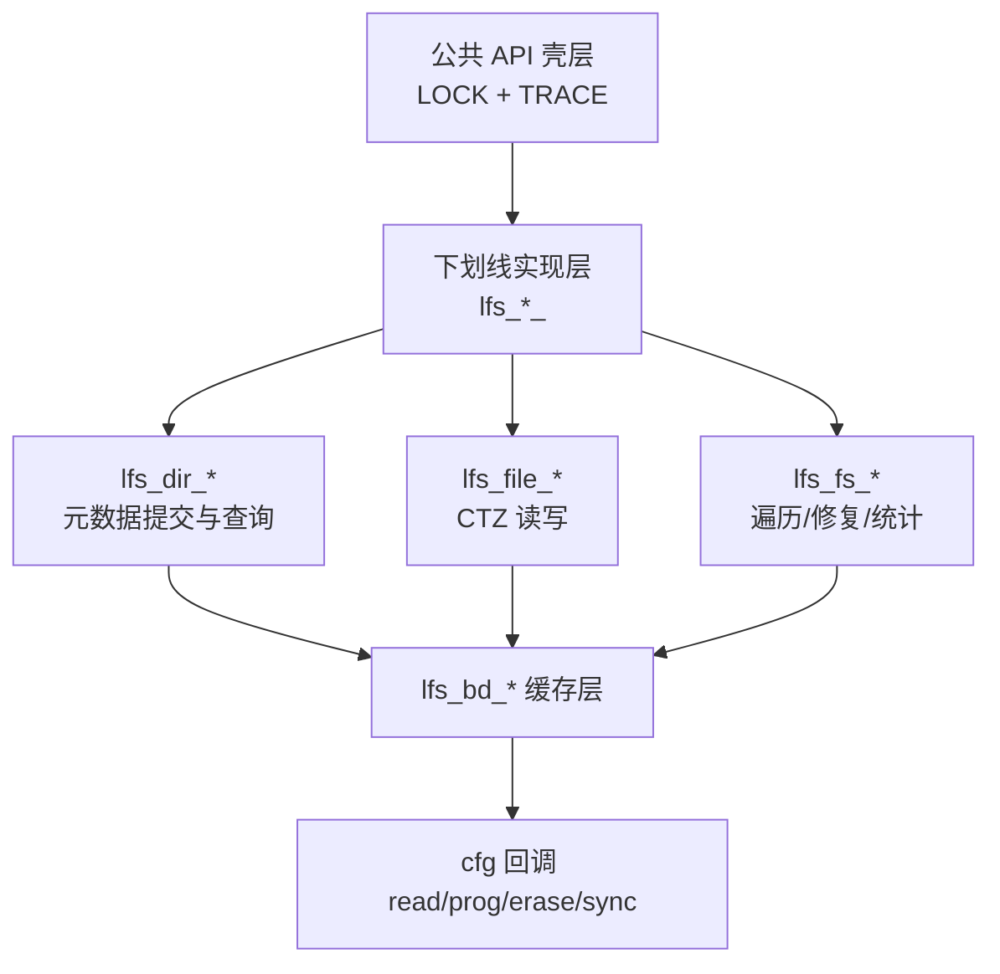
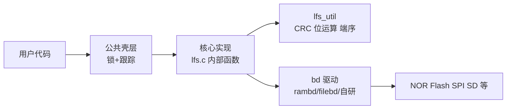

# littlefs 源码详解 06：API 逐条精读（lfs.h 全 API 表格）

> **涉及文件**
> - `lfs.h`（955 行，全部公共 API 与结构体）
> - `lfs.c`：公共壳层 `lfs_format`(6695) 起（LOCK→TRACE→内部实现→TRACE→UNLOCK）

公共壳层的三件套（见 lfs.c:6510 区注释）：

1. `LFS_LOCK/LFS_UNLOCK`：`LFS_THREADSAFE` 时全程持锁（粒度=整个调用）；
2. `LFS_TRACE`：进出参打印（默认空宏，零开销）；
3. `LFS_ASSERT(mlist)`：防重复打开/未开先用。

错误码约定：负数错误（`enum lfs_error`，lfs.h:83），正值/计数复用同一返回槽。

---

## 1. 文件系统生命周期

| API | 签名要点 | 语义 | 典型错误码 | 重入性 |
| --- | --- | --- | --- | --- |
| `lfs_format` | (lfs*, cfg) | 重建超块+根对；clobber lfs 对象，不保持挂载 | IO/CORRUPT/NOSPC | THREADSAFE 下互斥 |
| `lfs_mount` | (lfs*, cfg) | 扫超块链+聚合 gstate；cfg/lfs 须全程存活 | CORRUPT/INVAL | 同上 |
| `lfs_unmount` | (lfs*) | 释放缓存；无落盘尾巴（脏数据早提交了） | - | 同上 |

注意：`cfg->block_count=0` 允许"以盘上 superblock 为准"；
但 `lfs_format`/`lfs_migrate` 必须给非零值（断言）。

## 2. 通用操作

| API | 语义 | 错误码 | 备注 |
| --- | --- | --- | --- |
| `lfs_remove` | 删文件/空目录 | NOENT/NOTEMPTY/INVAL | 原子；目录删除走孤儿两步 |
| `lfs_rename` | 改名/移动 | NOENT/EXIST/ISDIR/NOTDIR/NOTEMPTY | 跨对两段式原子（gstate move） |
| `lfs_stat` | 查 type/size/name | NOENT/NOTDIR | size 仅 REG 有效 |
| `lfs_getattr` | 读属性 | NOATTR/NOENT | 返回盘上长度；缓冲小则截断 |
| `lfs_setattr` | 写属性（隐式建） | NOSPC/NOENT | 随 commit 原子生效 |
| `lfs_removeattr` | 删属性 | NOENT | 不存在也是 0 |

## 3. 文件操作

| API | 返回 | 语义/边界 | 掉电行为 |
| --- | --- | --- | --- |
| `lfs_file_open` | 0/负 | 默认配置；NO_MALLOC 下须用 opencfg | open 不产生盘上变化（除建条目） |
| `lfs_file_opencfg` | 0/负 | 静态缓冲+attrs | 同上 |
| `lfs_file_close` | 0/负 | 隐式 sync；ERRED 时跳过提交 | 半截数据绝不入库 |
| `lfs_file_sync` | 0/负 | 数据 sync→元数据 commit（顺序固定） | 元数据未提交=整批回滚 |
| `lfs_file_read` | 字节数/负 | EOF=0；READ 与 WRITING 互斥（先 flush） | 只读路径无掉电风险 |
| `lfs_file_write` | 字节数/负 | close/sync 前仅在 RAM；FBIG 拒绝超限 | 掉电丢未提交写，历史完好 |
| `lfs_file_seek` | 位置/负 | 同块缓存命中免 flush；INVAL 越界 | - |
| `lfs_file_truncate` | 0/负 | 缩到 inline_max 以下退回 inline | - |
| `lfs_file_tell/rewind/size` | 位置/0/大小 | size 含未提交写（max(pos,size)） | - |

## 4. 目录操作

| API | 返回 | 语义 |
| --- | --- | --- |
| `lfs_mkdir` | 0/负 | NOENT/EXIST/NAMETOOLONG；涉及链尾插入与孤儿计数 |
| `lfs_dir_open` | 0/负 | fetch 头块，登记 mlist |
| `lfs_dir_read` | **1/0/负** | 1=有条目，0=结束（与文件 read 不同！） |
| `lfs_dir_seek` | 0/负 | off 必须来自 tell；INVAL 否则 |
| `lfs_dir_tell` | 位置/负 | 数值仅作 seek 回放 |
| `lfs_dir_rewind` | 0/负 | 重新 fetch 头块 |
| `lfs_dir_close` | 0/负 | 摘 mlist |

迭代顺序：`.`、`..`、然后字典序（跨对沿 hardtail）。

## 5. 文件系统级操作

| API | 返回 | 语义 | 备注 |
| --- | --- | --- | --- |
| `lfs_fs_stat` | 0/负 | 盘上版本/几何/上限 | 旧次版本盘时版本读自超块 |
| `lfs_fs_size` | 块数/负 | 分配视角占用（best effort） | 共享 COW 块重复计 |
| `lfs_fs_traverse` | 0/负 | 遍历在用块；回调非 0 中断 | 镜像/坏块台账的地基 |
| `lfs_fs_mkconsistent` | 0/负 | 显式完成 move+孤儿+超块升级 | 幂等；无事也是 0 |
| `lfs_fs_gc` | 0/负 | mkconsistent+压实+预热分配器 | 建议空闲时段调用 |
| `lfs_fs_grow` | 0/负 | 扩容重写超块 | 收缩需 SHRINKNONRELOCATING |
| `lfs_migrate` | 0/负 | v1→v2 在线迁移（LFS_MIGRATE） | 掉电安全，可重跑 |

## 6. 打开标志与错误码速查

| 标志 | 值 | 含义 |
| --- | --- | --- |
| LFS_O_RDONLY | 1 | 只读 |
| LFS_O_WRONLY | 2 | 只写 |
| LFS_O_RDWR | 3 | 读写 |
| LFS_O_CREAT | 0x0100 | 不存在则创建 |
| LFS_O_EXCL | 0x0200 | 与 CREAT 连用：已存在则失败 |
| LFS_O_TRUNC | 0x0400 | 打开即清零 |
| LFS_O_APPEND | 0x0800 | 每次写前跳到末尾 |

| 错误码 | 值 | 场景 |
| --- | --- | --- |
| LFS_ERR_CORRUPT | -84 | CRC 失败/坏块/越界 |
| LFS_ERR_NOENT | -2 | 路径不存在 |
| LFS_ERR_EXIST | -17 | 重名 |
| LFS_ERR_NOTDIR / ISDIR | -20/-21 | 类型不符 |
| LFS_ERR_NOTEMPTY | -39 | 目录非空 |
| LFS_ERR_NOSPC | -28 | 真满（含坏块耗尽）/超块冻结 |
| LFS_ERR_NOATTR | -61 | 属性不存在 |
| LFS_ERR_NAMETOOLONG | -36 | 超 name_max |
| LFS_ERR_FBIG | -27 | 超 file_max |

## 7. 读路径全家桶（flowchart TD）

## 8. 数据流：API 分层（flowchart LR）

## 9. 陷阱与实测建议

- `lfs_dir_read` 返回 1/0 而非字节数，写 `while (lfs_dir_read(...) > 0)` 才对。
- `lfs_getattr` 的 size 语义（盘上长度）可用来"先探后读"两次调用。
- 所有 API 在 `LFS_THREADSAFE` 下互斥，但**跨 API 的一致性仍需调用方
  保证**（如两个任务各写同一文件）。
- 错误码直接来自 bd 回调时注意取负（filebd 的 `-errno` 模式值得照抄）。
