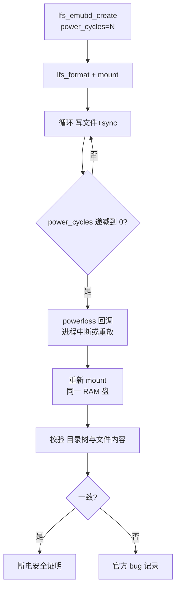
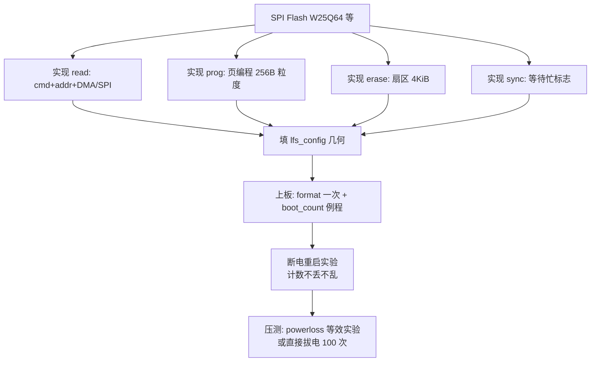
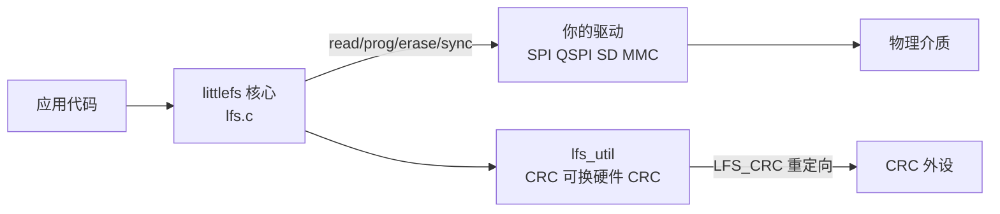

# littlefs 源码详解 07：移植与实测指南（bd 驱动 / PC 模拟 / 掉电实验）

> **涉及文件**
> - `lfs.h`：`struct lfs_config`(199)（移植的全部接口面）
> - `bd/lfs_rambd.c`(131 行)、`bd/lfs_filebd.c`(178 行)、`bd/lfs_emubd.c`(758 行)
> - `Makefile`、`scripts/test.py`、`runners/`

移植 littlefs = 实现 4 个回调 + 填 7 个参数。本文给出从"PC 模拟跑通"
到"真实 SPI Flash 上板"的完整路线，以及官方同款的掉电实验。

---

## 1. 四个回调的契约

| 回调 | 契约 | 可返回错误 |
| --- | --- | --- |
| `read(c,blk,off,buf,size)` | 任意对齐；同一地址反复读必须一致 | IO/CORRUPT |
| `prog(c,blk,off,buf,size)` | 目标必须已擦除；只能 1→0 | IO/CORRUPT（报坏块） |
| `erase(c,blk)` | 整块恢复全 1；擦除值不必是 0xff（NAND 常见 0x00） | IO/CORRUPT |
| `sync(c)` | **必须把写缓存真正落介质**，后续 read 能读到 | IO |

**sync 是掉电安全的生命线**：若驱动有写缓存而不冲刷，
littlefs 的"数据先于元数据落盘"就是空话。

## 2. 几何参数速查

```c
// 最小可用配置（16B 读写粒度, 4KiB 块, 512KiB 容量）
struct lfs_config cfg = {
    .read  = my_read,  .prog = my_prog,
    .erase = my_erase, .sync = my_sync,
    .read_size = 16, .prog_size = 16,
    .block_size = 4096, .block_count = 128,
    .cache_size = 16,           // 越大越快，RAM 换性能
    .lookahead_size = 16,       // 16B 位图 = 管 128 块
    .block_cycles = 500,        // 元数据搬迁阈值
};
```

硬性断言（lfs_init，lfs.c:4762）：

- `cache_size % read_size == 0`、`cache_size % prog_size == 0`；
- `block_size % cache_size == 0`；
- `block_size >= 128`（CTZ 指针不溢出）；
- `block_cycles != 0`（禁用填 -1）；
- `metadata_max`（若设）须整除 block_size。

RAM 预算：`2*cache_size + lookahead_size + N文件*cache_size + sizeof(lfs_t)`。

## 3. PC 模拟跑通（三条路）

### 3.1 rambd（最短路径）

```c
lfs_rambd_t ram;
cfg.context = &ram;
lfs_rambd_create(&cfg, &(struct lfs_rambd_config){
    .read_size=16, .prog_size=16, .erase_size=4096, .erase_count=128});
// 之后正常 lfs_format/lfs_mount
```

### 3.2 filebd（磁盘镜像）

```c
lfs_filebd_t fb;
cfg.context = &fb;
lfs_filebd_create(&cfg, "littlefs.img", &(struct lfs_filebd_config){
    .read_size=16, .prog_size=16, .erase_size=4096, .erase_count=128});
```

镜像可直接用 littlefs-fuse / littlefs-python / 网页查看器打开。

### 3.3 官方测试套件

```bash
make test                                  # 全量测试
./scripts/test.py -l runners/test_runner   # 列出测试套
./scripts/test.py runners/test_runner test_dirs          # 跑一个套件
./scripts/test.py runners/test_runner test_dirs_root:1g12gg2   # 单个排列
./scripts/test.py runners/test_runner -b -j               # 并行
./scripts/test.py runners/test_runner -ddisk /tmp/disk     # 导出盘镜像
```

## 4. 掉电实验（emubd 官方玩法）

`lfs_emubd_config` 的掉电三件套：

| 参数 | 作用 |
| --- | --- |
| `power_cycles = N` | 第 N 次写操作触发掉电 |
| `powerloss_behavior` | NOOP（写停在哪算哪）/ OOO（回滚 sync 前第一笔写） |
| `powerloss_cb` | 回调：`longjmp`/`exit`/继续跑都行 |



配套断言工具：`lfs_emubd_crc/bdcrc`（盘校验和）、
`lfs_emubd_wear`（逐块磨损）、`lfs_emubd_copy`（快照）。
官方 `tests/test_powerloss.toml` 就是把上述循环参数化后
生成的上千种排列。

## 5. 上板路线（flowchart TD）



上板要点：

- `prog` 逐页（常见 256 B）编程；`block_size` 可大于物理擦除粒度
  （littlefs 不关心，只要它是 read/prog 的倍数）；
- 多任务共享：定义 `LFS_THREADSAFE` 并给 `lock/unlock` 填互斥量；
- 无堆系统：提供 `read_buffer/prog_buffer/lookahead_buffer` +
  每文件 `lfs_file_config.buffer`，全静态零 malloc。

## 6. 移植数据流（flowchart LR）



## 7. 常见移植翻车清单

| 症状 | 根因 |
| --- | --- |
| 挂载报 CORRUPT | sync 未真正落盘（写缓存骗了 littlefs） |
| 写着写着 NOSPC | block_count 与实际不符 / 坏块全耗尽 |
| prog 后读回不对 | prog 未先 erase（块非全 1） |
| 断言 block_size>=128 失败 | 块太小，CTZ 指针区放不下 |
| 多线程偶发数据错乱 | 未开 LFS_THREADSAFE，两个任务并发进 API |
| RAM 越用越多 | 忘了 file cache 计入预算（每文件 cache_size） |

## 8. 与真实 flash 的咬合细节

- NOR 的"同一页内多次 prog"是允许的，littlefs 的元数据追加正靠它；
  但**每字节只能写一次**——littlefs 严守（这是 FCRC/valid 位设计的前提）。
- NAND 需要外加 ECC；littlefs 不做 ECC（DESIGN.md 明说），坏块靠
  prog 回读校验 + `LFS_ERR_CORRUPT` 上报来剔除。
- `erase_value` 不是 0xff 的介质（NAND/部分 SPI）由 emubd 模拟过，
  littlefs 本身不读擦除值，无需特殊配置。

## 9. 读码收官建议

按 00→02→01→03→04→05 的顺序读完 Docs 后，建议做一次"关掉注释重读"：
`git diff HEAD -- lfs.c | grep "^+.*@brief"` 快速过一遍全部 224 个
中文注释块，再挑 `lfs_dir_fetchmatch`（元数据对读取核心）与
`lfs_dir_commitcrc`（提交收尾）两个函数逐行精读——它们是
littlefs 掉电安全的"心脏与瓣膜"。
